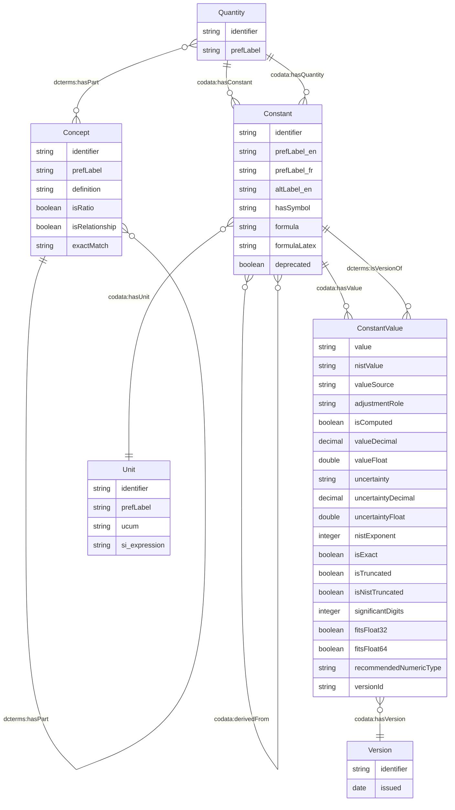

# CODATA Fundamental Physical Constants - Semantic Model

This document describes the semantic model for the CODATA fundamental physical constants dataset, represented in RDF Turtle format (`dist/rdf/codata_constants.ttl`) and formalized in the OWL/RDFS ontology ([`docs/codata.ttl`](codata.ttl)). The model captures physical quantities, constants, their values across different CODATA releases, associated metadata, and a rich conceptual taxonomy.

## Model Overview

The CODATA semantic model organizes fundamental physical constants in a structured hierarchy with the following key classes:

### Core Entities

1. **Concept** (`codata:Concept`, `skos:Concept`) - Taxonomic concepts that organize and categorize the domain knowledge (e.g., "SI Unit", "Elementary Particle", "Mass Ratio")
2. **Quantity** (`codata:Quantity`) - Represents a physical quantity or measurable property (e.g., "Electron Mass", "Speed Of Light In Vacuum"); every `codata:Quantity` is also a `codata:Concept`
3. **Constant** (`codata:Constant`) - Represents a specific physical constant with defined values across different CODATA release periods
4. **Unit** (`codata:Unit`) - Physical units of measurement (`kg`, `m_s-1`, `eV`, etc.) with UCUM and SI Digital Framework expressions
5. **Version** (`codata:Version`) - CODATA release versions with publication dates (`1998`, `2002`, `2006`, `2010`, `2014`, `2018`, `2022`)
6. **ConstantValue** (`codata:ConstantValue`) - Represents the measured/adopted value of a constant for a specific CODATA release version

### Key Properties

- **`codata:hasConstant`** - Links a `Quantity` to its associated `Constant` instances
- **`codata:hasValue`** - Links a `Constant` to its `ConstantValue` instances across different release years
- **`codata:hasUnit`** - Specifies the physical `Unit` for a `Constant`
- **`codata:hasQuantity`** - Links a `Constant` to its parent `Quantity`
- **`codata:hasVersion`** - Links a `ConstantValue` to its CODATA `Version`
- **`codata:derivedFrom`** - Links a computable `Constant` to input `Constant` nodes referenced in its algebraic formula
- **`codata:adjustmentRole`** (`xsd:string`) - Classifies an active constant into `"defining"`, `"computed_exact"`, `"adjusted"`, or `"computed_derived"`
- **`codata:isComputed`** (`xsd:boolean`) - `true` when the constant is algebraically computed from other constants (`computed_exact` or `computed_derived`), `false` otherwise
- **`codata:hasSymbol`** (`xsd:string`) - Standard mathematical LaTeX symbol for the constant (e.g., `\hbar`, `K_{\text{J}}`)
- **`codata:formula`** (`xsd:string`) - Safe Python/SymPy-compatible algebraic formula over canonical `Constant.id` identifiers
- **`codata:formulaLatex`** (`xsd:string`) - Display LaTeX formula corresponding to `codata:formula`
- **`codata:isRatio`** (`xsd:boolean`) - Emitted as `true` on `Concept` / `Quantity` nodes representing a dimensionless ratio
- **`codata:isRelationship`** (`xsd:boolean`) - Emitted as `true` on `Concept` / `Quantity` nodes representing a metrological equivalence or conversion relationship
- **`codata:value`** (`xsd:string`) - Highest mathematically valid canonical string representation of the constant value (matching NIST when exact or measured, or upgraded to full terminating rational / 34-digit IEEE 754 `decimal128` precision when NIST truncates a post-2019 computable exact constant)
- **`codata:nistValue`** (`xsd:string`) - Original verbatim NIST publication string preserved whenever `codata:valueSource` is `"computed"`
- **`codata:valueSource`** (`xsd:string`) - Provenance of `codata:value` (`"nist"` or `"computed"`)
- **`codata:valueDecimal`** (`xsd:decimal`) - Arbitrary-precision decimal representation used to verify lossless precision
- **`codata:valueFloat`** (`xsd:double`) - IEEE 754 double-precision floating-point representation in scientific notation
- **`codata:uncertainty`** (`xsd:string`) - The canonical string representation of the standard uncertainty as published by NIST/CODATA
- **`codata:uncertaintyDecimal`** (`xsd:decimal`) - Arbitrary-precision decimal representation of the standard uncertainty
- **`codata:uncertaintyFloat`** (`xsd:double`) - IEEE 754 double-precision floating-point representation of the standard uncertainty
- **`codata:nistExponent`** (`xsd:integer`) - The base-10 publication scale factor used in the NIST ASCII table for display grouping (note: this reflects NIST's tabular display exponent and may differ from a normalized mantissa exponent)
- **`codata:isExact`** (`xsd:boolean`) - Indicates if the value is exact by definition (zero uncertainty)
- **`codata:isTruncated`** (`xsd:boolean`) - Emitted as `true` only when the primary DRUM `value` itself remains truncated (symmetric with `codata:isNistTruncated`)
- **`codata:isNistTruncated`** (`xsd:boolean`) - Preserved `true` flag whenever the original NIST ASCII table row ended with `...` truncation
- **`codata:significantDigits`** (`xsd:integer`) - Count of significant decimal digits in `codata:value` (preserving significant trailing zeros)
- **`codata:fitsFloat32`** (`xsd:boolean`) - True when `codata:value` is non-truncated and fits losslessly in IEEE 754 binary32
- **`codata:fitsFloat64`** (`xsd:boolean`) - True when `codata:value` is non-truncated and fits losslessly in IEEE 754 binary64
- **`codata:recommendedNumericType`** (`xsd:string`) - Smallest lossless storage class (`"float32"`, `"float64"`, or `"decimal"`)
- **`codata:versionId`** (`xsd:string`) - Release year identifier for the CODATA adjustment (e.g., `"2022"`)
- **`owl:deprecated`** (`xsd:boolean`) - Marks historical constants that were discontinued in the current CODATA adjustment (e.g., conventional electric units retired after the 2019 SI redefinition)
- **`skos:broader`** - Hierarchical relationships in the concept taxonomy
- **`dcterms:hasPart`** - Part-whole relationships between concepts (used to link quantities to their constituent concepts)
- **`dcterms:isVersionOf`** - Links versioned constant values back to their parent constant
- **`dcterms:issued`** - Publication date of a CODATA version
- **`schema:identifier`** - String identifiers and `schema:PropertyValue` cross-references (`#NIST`, `#QUDT`, `#SI`, `#UCUM`)
- **`skos:prefLabel`** - Preferred human-readable labels (`@en` and `@fr`)
- **`skos:altLabel`** - Alternative labels preserving the exact lowercase NIST/BIPM source strings (`@en` and `@fr`)
- **`skos:definition`** - Concept definitions (`@en` and `@fr`) where curated
- **`skos:exactMatch`** - Links to equivalent entities in external vocabularies (e.g., Wikidata)
- **`rdfs:seeAlso`** - External reference links (e.g., Wikipedia articles on units)

### Namespaces

- `codata:` - CODATA model namespace: `https://w3id.org/codata/model/`
- `concept:` - Concepts namespace: `https://w3id.org/codata/concepts/`
- `constant:` - Constants namespace: `https://w3id.org/codata/constants/`
- `quantity:` - Quantities namespace: `https://w3id.org/codata/quantities/`
- `unit:` - Units namespace: `https://w3id.org/codata/units/`
- `version:` - Versions namespace: `https://w3id.org/codata/constants/versions/`
- `ucum:` - Units of Measure: `https://w3id.org/uom/`
- `si-unit:` - SI Digital Framework Units: `https://si-digital-framework.org/SI/units/`
- `si-constant:` - SI Digital Framework Constants: `https://si-digital-framework.org/constants/`
- `qudt:` - QUDT Constants Vocabulary: `http://qudt.org/vocab/constant/`
- `wikidata:` - Wikidata entities: `https://www.wikidata.org/entity/`
- `schema:` - Schema.org vocabulary: `https://schema.org/`
- `skos:` - SKOS vocabulary: `http://www.w3.org/2004/02/skos/core#`
- `dcterms:` - Dublin Core Terms: `http://purl.org/dc/terms/`
- `owl:` - Web Ontology Language: `http://www.w3.org/2002/07/owl#`

## Numeric Precision Strategy

Each `codata:ConstantValue` provides three complementary representations for both the value and its uncertainty:

1. **Canonical String (`codata:value` / `codata:uncertainty`, `xsd:string`)**: Mirrors the exact string published by NIST (after stripping spaces), preserving significant trailing zeros.
2. **Double-Precision Float (`codata:valueFloat` / `codata:uncertaintyFloat`, `xsd:double`)**: Provides standard scientific-notation floating-point literals (e.g., `6.62607015e-34`) for numerical computation and SPARQL arithmetic.
3. **Arbitrary-Precision Decimal (`codata:valueDecimal` / `codata:uncertaintyDecimal`, `xsd:decimal`)**: Provides an exact base-10 decimal literal constructed via Python's `Decimal` class to verify that no binary floating-point rounding occurs during serialization and round-tripping. Note that because the W3C XML Schema (`xsd:decimal`) and W3C RDF 1.1 Turtle grammar (`DECIMAL ::= [+-]? [0-9]* '.' [0-9]+`) prohibit exponent notation (`e-34`) on `xsd:decimal` literals, `valueDecimal` is serialized in fixed-point form in Turtle while `valueFloat` carries the scientific notation.

## Entity Relationship Diagram



## Sample Data Structure

### Concept Example
```turtle
concept:AlphaParticle a codata:Concept ;
    skos:prefLabel "Alpha Particle"@en ;
    schema:identifier "AlphaParticle" .

concept:MassRatio a codata:Concept ;
    dcterms:hasPart concept:Ratio, quantity:Mass ;
    skos:prefLabel "Mass Ratio"@en ;
    schema:identifier "MassRatio" .
```

### Quantity Example
```turtle
quantity:AlphaParticleElectronMassRatio a codata:Concept, codata:Quantity ;
    dcterms:hasPart concept:AlphaParticle,
        concept:Electron,
        concept:MassRatio,
        concept:Ratio ;
    skos:prefLabel "Alpha Particle - Electron Mass Ratio"@en ;
    schema:identifier "AlphaParticleElectronMassRatio" ;
    codata:hasConstant constant:AlphaParticleElectronMassRatio .
```

### Constant Example (Computable Exact Constant)
```turtle
constant:ReducedPlanckConstant a codata:Constant ;
    skos:altLabel "reduced Planck constant"@en,
        "constante de Planck réduite"@fr ;
    skos:prefLabel "Reduced Planck Constant"@en,
        "Constante de Planck réduite"@fr ;
    schema:identifier <https://w3id.org/codata/constants/ReducedPlanckConstant#NIST>,
        <https://w3id.org/codata/constants/ReducedPlanckConstant#QUDT>,
        "ReducedPlanckConstant" ;
    codata:adjustmentRole "computed_exact" ;
    codata:isComputed true ;
    codata:hasSymbol "\\hbar" ;
    codata:formula "PlanckConstant / (2 * pi)" ;
    codata:formulaLatex "\\frac{h}{2\\pi}" ;
    codata:derivedFrom constant:PlanckConstant ;
    codata:hasQuantity quantity:ReducedPlanckConstant ;
    codata:hasUnit unit:J_s ;
    codata:hasValue <https://w3id.org/codata/constants/ReducedPlanckConstant/1998>,
        <https://w3id.org/codata/constants/ReducedPlanckConstant/2002>,
        <https://w3id.org/codata/constants/ReducedPlanckConstant/2006>,
        <https://w3id.org/codata/constants/ReducedPlanckConstant/2010>,
        <https://w3id.org/codata/constants/ReducedPlanckConstant/2014>,
        <https://w3id.org/codata/constants/ReducedPlanckConstant/2018>,
        <https://w3id.org/codata/constants/ReducedPlanckConstant/2022> .
```

### ConstantValue Example (Upgraded Exact Value + NIST Provenance)
```turtle
<https://w3id.org/codata/constants/ReducedPlanckConstant/2022> a codata:ConstantValue ;
    dcterms:isVersionOf constant:ReducedPlanckConstant ;
    skos:prefLabel "2022 Reduced Planck Constant"@en ;
    codata:hasVersion version:2022 ;
    codata:versionId "2022" ;
    codata:isExact true ;
    codata:isTruncated true ;
    codata:isNistTruncated true ;
    codata:nistExponent -34 ;
    codata:valueSource "computed" ;
    codata:nistValue "1.054571817e-34" ;
    codata:value "1.05457181764615639126242800330228e-34"^^xsd:string ;
    codata:valueDecimal 0.000000000000000000000000000000000105457181764615639126242800330228 ;
    codata:valueFloat 1.0545718176461565e-34 ;
    codata:significantDigits 33 ;
    codata:fitsFloat32 false ;
    codata:fitsFloat64 false ;
    codata:recommendedNumericType "decimal" .
```

### Unit Example  
```turtle
unit:kg a codata:Unit ;
    skos:prefLabel "kilogram"@en ;
    schema:identifier <https://w3id.org/codata/units/kg#SI>,
        <https://w3id.org/codata/units/kg#UCUM>,
        "kg" ;
    ucum:ucum "kg" ;
    ucum:si_expression "kg" .
```

### Version Example
```turtle
version:2022 a codata:Version ;
    dcterms:issued "2024-05-09"^^xsd:date ;
    schema:identifier "2022" .
```

## Sample SPARQL Queries

### 1. Find All Constants with Their Latest Values (2022)

```sparql
PREFIX codata: <https://w3id.org/codata/model/>
PREFIX constant: <https://w3id.org/codata/constants/>
PREFIX version: <https://w3id.org/codata/constants/versions/>
PREFIX skos: <http://www.w3.org/2004/02/skos/core#>
PREFIX dcterms: <http://purl.org/dc/terms/>

SELECT ?constant ?label ?value ?uncertainty ?unit ?isExact
WHERE {
    ?constant a codata:Constant ;
              skos:prefLabel ?label ;
              codata:hasValue ?constantValue .
    
    ?constantValue codata:hasVersion version:2022 ;
                   codata:value ?value ;
                   codata:isExact ?isExact ;
                   dcterms:isVersionOf ?constant .
    
    OPTIONAL { ?constantValue codata:uncertainty ?uncertainty }
    OPTIONAL { ?constant codata:hasUnit ?unit }
    
    FILTER(lang(?label) = "en")
}
ORDER BY ?label
```

### 2. Find All SI Defining Constants

```sparql
PREFIX codata: <https://w3id.org/codata/model/>
PREFIX concept: <https://w3id.org/codata/concepts/>
PREFIX skos: <http://www.w3.org/2004/02/skos/core#>
PREFIX dcterms: <http://purl.org/dc/terms/>

SELECT ?constant ?label ?concept_label
WHERE {
    ?constant a codata:Constant ;
              codata:hasQuantity ?quantity ;
              skos:prefLabel ?label .
    
    ?quantity dcterms:hasPart ?concept .
    ?concept skos:broader* concept:SIDefiningConstant ;
             skos:prefLabel ?concept_label .
    FILTER(lang(?label) = "en")
    FILTER(lang(?concept_label) = "en")
}
ORDER BY ?label
```

### 3. Find Particle Mass Ratios

```sparql
PREFIX codata: <https://w3id.org/codata/model/>
PREFIX concept: <https://w3id.org/codata/concepts/>
PREFIX quantity: <https://w3id.org/codata/quantities/>
PREFIX version: <https://w3id.org/codata/constants/versions/>
PREFIX skos: <http://www.w3.org/2004/02/skos/core#>
PREFIX dcterms: <http://purl.org/dc/terms/>

SELECT ?quantity ?label ?latest_value
WHERE {
    ?quantity a codata:Quantity ;
              dcterms:hasPart concept:MassRatio ;
              skos:prefLabel ?label ;
              codata:hasConstant ?constant .
    
    ?constant codata:hasValue ?value .
    ?value codata:hasVersion version:2022 ;
           codata:value ?latest_value .
    FILTER(lang(?label) = "en")
}
ORDER BY ?label
```

### 4. Find Units and Their UCUM Codes

```sparql
PREFIX codata: <https://w3id.org/codata/model/>
PREFIX unit: <https://w3id.org/codata/units/>
PREFIX ucum: <https://w3id.org/uom/>
PREFIX skos: <http://www.w3.org/2004/02/skos/core#>
PREFIX schema: <https://schema.org/>

SELECT ?unit ?label ?ucum_code ?si_expression
WHERE {
    ?unit a codata:Unit ;
          skos:prefLabel ?label ;
          schema:identifier ?identifier .
    FILTER(isLiteral(?identifier))
    FILTER(lang(?label) = "en")
    
    OPTIONAL { ?unit ucum:ucum ?ucum_code }
    OPTIONAL { ?unit ucum:si_expression ?si_expression }
}
ORDER BY ?label
```

### 5. Evolution of a Constant Over Time

```sparql
PREFIX codata: <https://w3id.org/codata/model/>
PREFIX constant: <https://w3id.org/codata/constants/>
PREFIX version: <https://w3id.org/codata/constants/versions/>
PREFIX dcterms: <http://purl.org/dc/terms/>
PREFIX skos: <http://www.w3.org/2004/02/skos/core#>
PREFIX schema: <https://schema.org/>

SELECT ?version_year ?issued_date ?value ?uncertainty
WHERE {
    constant:SpeedOfLight codata:hasValue ?constantValue .
    
    ?constantValue dcterms:isVersionOf constant:SpeedOfLight ;
                   codata:hasVersion ?version ;
                   codata:value ?value .
    
    ?version schema:identifier ?version_year ;
             dcterms:issued ?issued_date .
    
    OPTIONAL { ?constantValue codata:uncertainty ?uncertainty }
}
ORDER BY ?version_year
```

### 6. Find All Exact Constants (No Uncertainty)

```sparql
PREFIX codata: <https://w3id.org/codata/model/>
PREFIX version: <https://w3id.org/codata/constants/versions/>
PREFIX skos: <http://www.w3.org/2004/02/skos/core#>

SELECT ?constant ?label
WHERE {
    ?constant a codata:Constant ;
              skos:prefLabel ?label ;
              codata:hasValue ?value .
    
    ?value codata:isExact true ;
           codata:hasVersion version:2022 .
    FILTER(lang(?label) = "en")
}
ORDER BY ?label
```

### 7. Conceptual Hierarchy Navigation

```sparql
PREFIX concept: <https://w3id.org/codata/concepts/>
PREFIX skos: <http://www.w3.org/2004/02/skos/core#>
PREFIX dcterms: <http://purl.org/dc/terms/>

SELECT ?broader_concept ?concept ?concept_label ?part
WHERE {
    ?concept skos:broader ?broader_concept ;
             skos:prefLabel ?concept_label .
    
    OPTIONAL { ?concept dcterms:hasPart ?part }
    
    ?broader_concept skos:prefLabel "SI Unit"@en .
    FILTER(lang(?concept_label) = "en")
}
```

### 8. CODATA Version Information

```sparql
PREFIX codata: <https://w3id.org/codata/model/>
PREFIX version: <https://w3id.org/codata/constants/versions/>
PREFIX dcterms: <http://purl.org/dc/terms/>
PREFIX schema: <https://schema.org/>

SELECT ?version ?year ?issued_date ?constant_count
WHERE {
    ?version a codata:Version ;
             schema:identifier ?year ;
             dcterms:issued ?issued_date .
    
    {
        SELECT ?version (COUNT(DISTINCT ?constant_value) AS ?constant_count)
        WHERE {
            ?constant_value codata:hasVersion ?version .
        }
        GROUP BY ?version
    }
}
ORDER BY ?year
```

### 9. Compare Planck Constant Values Across All CODATA Releases

```sparql
PREFIX codata: <https://w3id.org/codata/model/>
PREFIX constant: <https://w3id.org/codata/constants/>
PREFIX skos: <http://www.w3.org/2004/02/skos/core#>

SELECT ?version ?value ?uncertainty
WHERE {
    constant:PlanckConstant codata:hasValue ?constantValue .
    
    ?constantValue codata:versionId ?version ;
                   codata:value ?value .
    
    OPTIONAL { ?constantValue codata:uncertainty ?uncertainty }
}
ORDER BY ?version
```

### 10. Find All Electron-Related Constants

```sparql
PREFIX codata: <https://w3id.org/codata/model/>
PREFIX quantity: <https://w3id.org/codata/quantities/>
PREFIX constant: <https://w3id.org/codata/constants/>
PREFIX skos: <http://www.w3.org/2004/02/skos/core#>
PREFIX schema: <https://schema.org/>

SELECT DISTINCT ?quantity ?constant ?label
WHERE {
    ?quantity a codata:Quantity ;
              schema:identifier ?quantityId ;
              codata:hasConstant ?constant .
    
    ?constant skos:prefLabel ?label .
    
    FILTER(CONTAINS(LCASE(?quantityId), "electron") || CONTAINS(LCASE(?label), "electron"))
    FILTER(lang(?label) = "en")
}
ORDER BY ?label
```

### 11. Find Constants with Values in SI Base Units

```sparql
PREFIX codata: <https://w3id.org/codata/model/>
PREFIX constant: <https://w3id.org/codata/constants/>
PREFIX skos: <http://www.w3.org/2004/02/skos/core#>

SELECT ?constant ?label ?value ?uncertainty ?unit
WHERE {
    ?constant a codata:Constant ;
              skos:prefLabel ?label ;
              codata:hasValue ?constantValue ;
              codata:hasUnit ?unit .
    
    ?constantValue codata:versionId "2022" ;
                   codata:value ?value .
    
    OPTIONAL { ?constantValue codata:uncertainty ?uncertainty }
    
    FILTER(
        ?unit IN (
            <https://w3id.org/codata/units/kg>,
            <https://w3id.org/codata/units/m>,
            <https://w3id.org/codata/units/s>,
            <https://w3id.org/codata/units/A>,
            <https://w3id.org/codata/units/K>,
            <https://w3id.org/codata/units/mol>,
            <https://w3id.org/codata/units/cd>
        )
    )
    
    FILTER(lang(?label) = "en")
}
ORDER BY ?unit ?label
```

### 12. Evolution of Measurement Precision Over Time

```sparql
PREFIX codata: <https://w3id.org/codata/model/>
PREFIX constant: <https://w3id.org/codata/constants/>
PREFIX skos: <http://www.w3.org/2004/02/skos/core#>
PREFIX xsd: <http://www.w3.org/2001/XMLSchema#>

SELECT ?constant ?label ?version ?value ?uncertainty ?relativeUncertainty
WHERE {
    ?constant a codata:Constant ;
              skos:prefLabel ?label ;
              codata:hasValue ?constantValue .
    
    ?constantValue codata:versionId ?version ;
                   codata:valueFloat ?value ;
                   codata:uncertaintyFloat ?uncertainty .
    
    BIND((?uncertainty / ABS(?value)) AS ?relativeUncertainty)
    
    FILTER(lang(?label) = "en")
    FILTER(?relativeUncertainty > 0)
}
ORDER BY ?constant ?version
```

### 13. Find Constants Related to Fundamental Particles

```sparql
PREFIX codata: <https://w3id.org/codata/model/>
PREFIX quantity: <https://w3id.org/codata/quantities/>
PREFIX constant: <https://w3id.org/codata/constants/>
PREFIX skos: <http://www.w3.org/2004/02/skos/core#>
PREFIX schema: <https://schema.org/>

SELECT DISTINCT ?particle ?constant ?label ?value2022
WHERE {
    VALUES ?particle { "electron" "proton" "neutron" "muon" "tau" "alpha" }
    
    ?quantity a codata:Quantity ;
              schema:identifier ?quantityId ;
              codata:hasConstant ?constant .
    
    ?constant skos:prefLabel ?label ;
              codata:hasValue ?constantValue2022 .
    
    ?constantValue2022 codata:versionId "2022" ;
                       codata:value ?value2022 .
    
    FILTER(CONTAINS(LCASE(?quantityId), ?particle) || CONTAINS(LCASE(?label), ?particle))
    FILTER(lang(?label) = "en")
}
ORDER BY ?particle ?label
```

### 14. Inspect Two-Source Precision Upgrades (`value` vs. `nistValue`) for Exact Computable Constants

```sparql
PREFIX codata: <https://w3id.org/codata/model/>
PREFIX version: <https://w3id.org/codata/constants/versions/>
PREFIX skos: <http://www.w3.org/2004/02/skos/core#>

SELECT ?constant ?label ?symbol ?formula ?nistValue ?primaryValue ?isNistTruncated ?isTruncated ?sigDigits ?recType
WHERE {
    ?constant a codata:Constant ;
              skos:prefLabel ?label ;
              codata:formula ?formula ;
              codata:hasValue ?val .
    ?val codata:hasVersion version:2022 ;
         codata:adjustmentRole "computed_exact" ;
         codata:value ?primaryValue ;
         codata:valueSource "computed" ;
         codata:nistValue ?nistValue ;
         codata:isNistTruncated ?isNistTruncated ;
         codata:significantDigits ?sigDigits ;
         codata:recommendedNumericType ?recType .
    OPTIONAL { ?constant codata:hasSymbol ?symbol }
    OPTIONAL { ?val codata:isTruncated ?isTruncated }
    FILTER(lang(?label) = "en")
}
ORDER BY ?constant
```

### 15. Traverse Formula Dependencies (`codata:derivedFrom`) Requiring Arbitrary-Precision `decimal` Storage (2022)

```sparql
PREFIX codata: <https://w3id.org/codata/model/>
PREFIX version: <https://w3id.org/codata/constants/versions/>
PREFIX skos: <http://www.w3.org/2004/02/skos/core#>

SELECT ?constant ?label ?role ?sigDigits (GROUP_CONCAT(DISTINCT ?depLabel; separator=", ") AS ?dependencies)
WHERE {
    ?constant a codata:Constant ;
              skos:prefLabel ?label ;
              codata:derivedFrom ?dep ;
              codata:hasValue ?val .
    ?dep skos:prefLabel ?depLabel .
    ?val codata:hasVersion version:2022 ;
         codata:adjustmentRole ?role ;
         codata:recommendedNumericType "decimal" ;
         codata:significantDigits ?sigDigits .
    FILTER(lang(?label) = "en")
    FILTER(lang(?depLabel) = "en")
}
GROUP BY ?constant ?label ?role ?sigDigits
ORDER BY DESC(?sigDigits) ?constant
```

### 16. Track SI Redefinition Role Transitions Across Releases (2014 vs. 2018)

```sparql
PREFIX codata: <https://w3id.org/codata/model/>
PREFIX version: <https://w3id.org/codata/constants/versions/>
PREFIX skos: <http://www.w3.org/2004/02/skos/core#>
PREFIX dcterms: <http://purl.org/dc/terms/>

SELECT ?constant ?label ?role2014 ?role2018 ?exact2014 ?exact2018
WHERE {
    ?v2014 codata:hasVersion version:2014 ;
           dcterms:isVersionOf ?constant ;
           codata:adjustmentRole ?role2014 ;
           codata:isExact ?exact2014 .
    ?v2018 codata:hasVersion version:2018 ;
           dcterms:isVersionOf ?constant ;
           codata:adjustmentRole ?role2018 ;
           codata:isExact ?exact2018 .
    ?constant skos:prefLabel ?label .
    FILTER (?role2014 != ?role2018)
    FILTER (lang(?label) = "en")
}
ORDER BY ?constant
```

## Known Limitations & Future Roadmap

1. **Covariance & Correlation Matrix**: The 2022 CODATA recommended values are the output of a least-squares adjustment over jointly-fitted constants (Mohr et al. 2025, *Rev. Mod. Phys.* 97, 025002). While `v0.4.0` exposes determination roles (`codata:adjustmentRole`), algebraic dependency graphs (`codata:formula`, `codata:derivedFrom`), and two-source precision metadata (`docs/COMPUTABLE_CONSTANTS.md`), the DRUM knowledge graph does not yet expose the pairwise correlation coefficients (`corrcoef`). Consumers propagating uncertainties across derived constants whose adjusted inputs are correlated must account for covariance.
2. **Primary Truncation Flag (`codata:isTruncated`) vs. NIST Source Truncation (`codata:isNistTruncated`)**: Both flags are emitted symmetrically as `true` only when truncation applies across all CODATA releases—`codata:isTruncated` when the primary DRUM value itself remains truncated (irrational or infinite repeating rational), and `codata:isNistTruncated` when the original NIST ASCII table row ended with `...`.

## Data Sources

This semantic model is generated from the official CODATA fundamental physical constants datasets:
- NIST Fundamental Physical Constants (SP 961 / SP 959 May 2024; SRD 121): https://physics.nist.gov/cuu/Constants/
- CODATA 2022 adjustment: Mohr, P. J., Newell, D. B., Taylor, B. N., & Tiesinga, E. (2025), *Rev. Mod. Phys.* 97, 025002 — https://doi.org/10.1103/RevModPhys.97.025002
- CODATA 2018 adjustment: Tiesinga, E., Mohr, P. J., Newell, D. B., & Taylor, B. N. (2021), *Rev. Mod. Phys.* 93, 025010 / *J. Phys. Chem. Ref. Data* 50, 033105 — https://doi.org/10.1103/RevModPhys.93.025010
- BIPM 9th SI Brochure (2019) and 2017 Special Adjustment (Mohr et al. 2018, *Metrologia* 55, 125; Newell et al. 2018, *Metrologia* 55, L13). See [`docs/COMPUTABLE_CONSTANTS.md`](COMPUTABLE_CONSTANTS.md) for the complete bibliography.

## License

- **Data & Ontology**: Licensed under [Creative Commons Attribution 4.0 International (CC BY 4.0)](http://creativecommons.org/licenses/by/4.0/).
- **Software & Scripts**: Licensed under [Apache License 2.0](https://www.apache.org/licenses/LICENSE-2.0.txt).
