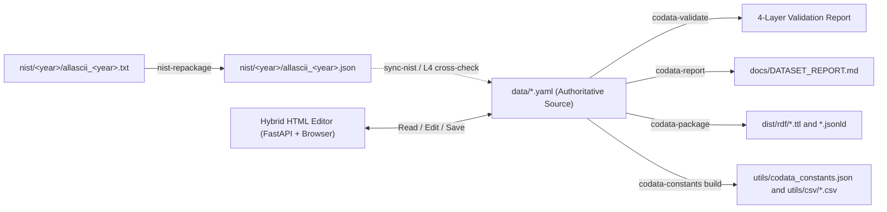

# Transition Report: Google Sheets to GitHub-Native YAML Curation (`v0.3.0`)

**Date**: 2026-11-20  
**Project**: `codata-drum-constants` (`v0.2.0` → `v0.3.0`)  
**Scope**: Migration of CODATA DRUM fundamental physical constants curation from an external Google Sheet / Excel workbook (`utils/codata_constants.xlsx`) to modular Git-tracked YAML files (`data/*.yaml`), backed by Pydantic v2 validation, Markdown reporting, direct YAML-to-RDF packaging, and a hybrid browser/FastAPI HTML editor.

---

## 1. Executive Summary & Motivation

Previously, editorial curation for CODATA DRUM constants (SKOS taxonomy, quantity groupings, multilingual `@en`/`@fr` labels, and external crosswalks to QUDT, UCUM, SI Digital Framework, and Wikidata) lived in an external Google Sheet downloaded as `utils/codata_constants.xlsx`. While `utils/codata_constants.py` exported CSV snapshots for pull-request diffs, the spreadsheet remained the editing bottleneck: formulas silently broke or diverged from Python logic, Google Sheets evaluated `COUNTIF` case-insensitively (`Ae` vs. `ae`), and contributors could not curate directly via Git pull requests or run pre-commit schema validation.

With `v0.3.0`, **`data/*.yaml` is the single authoritative source of truth** in the repository:

| Metric | Value |
|---|---:|
| CODATA Release Versions (`1998`–`2022`) | 7 |
| Physical Constants (Total / Active in `2022` / Deprecated) | 359 / 355 / 4 |
| Versioned Constant Values (`1998`–`2022`) | 2,313 |
| Physical Quantities | 306 |
| Taxonomic Concepts | 442 |
| Measurement Units | 84 |
| NIST Values Cross-Checked (`nist/<year>/allascii_<year>.json`) | 2,313 / 2,313 (0 mismatches) |
| 2022 Metrological Identities Passed | 9 / 9 |
| Validation Errors | 0 |

---

## 2. Architecture & Pipeline Comparison

### Target YAML-First Pipeline



### Retired vs. Introduced Components

| Area | Legacy (`v0.2.0`) | YAML-First (`v0.3.0`) |
|---|---|---|
| **Authoritative Source** | Google Sheet + `utils/codata_constants.xlsx` (retired) | `data/versions.yaml`, `data/units.yaml`, `data/concepts.yaml`, `data/quantities.yaml`, `data/constants.yaml` |
| **NIST Name/ID Lookup** | `utils/csv/nist_names_ids.csv` (retired) + `nist/nist_ids.json` | Consolidated in `nist/repackage.py` (`nist/nist_ids.json` + `.csv`) |
| **Data & Schema Modeling** | Untyped Excel cell reads in `utils/codata_constants.py` | Pydantic v2 models + computed fields in `utils/models.py` |
| **YAML I/O & Legacy Exports** | Workbook reader + CSV snapshot dumper | Atomic `CodataYamlDumper` + JSON/CSV exporters in `utils/dataset.py` |
| **Validation** | Post-RDF precision + 6 pytest checks only | 4-layer validator in `utils/validate.py` (`codata-validate`) |
| **Reporting** | None for dataset curation | Automated `docs/DATASET_REPORT.md` via `utils/report.py` (`codata-report`) |
| **Interactive Editor** | Google Sheets web UI | Hybrid HTML editor (`utils/editor.py` + `utils/editor/index.html`, `codata-editor`) |
| **RDF Packaging** | Read `utils/codata_constants.json` | Reads `data/*.yaml` directly in `utils/package.py` (`codata-package`) |
| **Dependencies** | `openpyxl>=3.1.0` (removed) | `pyyaml`, `pydantic`, `typer`, `fastapi`, `uvicorn` (dev: `httpx`) |

---

## 3. Modular YAML Data Model & Precision Guarantees

The dataset is split across five deterministically sorted files under `data/`:

1. **`data/versions.yaml`** (7 records, sorted descending by `id`): CODATA adjustment years (`"2022"` down to `"1998"`), ISO publication dates, and optional descriptions.
2. **`data/units.yaml`** (84 records, sorted ascending by `id`): unit IDs, names, constituent `parts`, `si_expression`, external `ids` (`SI`, `UCUM`, `WIKIDATA`), and optional `wikipedia` links.
3. **`data/concepts.yaml`** (442 records, sorted ascending by `id`): SKOS taxonomy nodes (`broader`, `parts`, `related`, `same_as`, `groups`), bilingual `name` / `name_fr` / `definition` / `definition_fr`, `notation_tex`, `is_ratio`, `is_relationship`, and `WIKIDATA` identifiers.
4. **`data/quantities.yaml`** (306 records, sorted ascending by `id`): measurable physical properties (`id`, `name`, `notation`, `definition`, `has_parts`, `same_as`, `ids`).
5. **`data/constants.yaml`** (359 constants, 2,313 versioned values; sorted ascending by constant `id`, with `values` sorted descending by `version`): `quantity_id`, `unit_id`, `unit_nist`, multilingual labels (`name`, `name_fr`, `name_bipm_en`, `name_bipm_fr`), external `ids` (`NIST`, `QUDT`, `SI`, `UCUM`), and historical NIST release `values`.

### Precision & Lossless Serialization

- **Strict String Preservation**: `ConstantValueModel` requires `value`, `uncertainty`, and `version` to be strings (`Decimal`-validated, rejecting spaces or `...`). `CodataYamlDumper` in `utils/dataset.py` automatically double-quotes numeric, ISO date, and YAML-ambiguous scalars (e.g., `"6.6446573450e-27"`, `"0.0000000021e-27"`, `"2022"`, `"2024-05-09"`) so trailing significant zeros are never stripped by YAML parsers.
- **Previously Dropped Curation Preserved**: Curated columns that existed in the spreadsheet/CSV snapshots but were previously skipped by `utils/codata_constants.py`—including `Concept.definition`, `Concept.notation_tex`, `Quantity.notation`, `Constant.unit_nist`, `Constant.ids.UCUM`, `Unit.parts`, and `Unit.wikipedia`—are now stored directly in YAML.
- **Atomic Writes & Clean Diffs**: `save_entity_file()` and `save_dataset()` omit `None` and empty optional fields, sort deterministically, and write via temporary files + `os.replace`.

---

## 4. Mapping Google Sheet Computed Columns & Consolidating `nist_names_ids`

Inspecting the raw XML formulas inside `utils/codata_constants.xlsx` revealed three categories of computed columns:

| Category | Workbook Columns | Handling in YAML Architecture |
|---|---|---|
| **A — Pure Lookups, Counts & URLs** (100% formula-driven, 0 static overrides) | `Concepts`: `is_quantity`, `wikidata_url`<br>`Quantities`: `has_concept`, `n_constants`, `uri`<br>`Constants`: `unit_id_lookup`, `quantity_id_lookup`, `is_base`, `qudt_url`, `is_qudt`, `si_url`, `versions`, `is_2022`..`is_1998`<br>`Units`: `si_uri`, `ucum_uri`, `n_constants` | **Omitted from YAML**; implemented as `@computed_field` / methods in `utils/models.py`, enforced by `utils/validate.py`, shown live in the HTML editor, and regenerated in `utils/csv/*.csv` (fixing the Google Sheets case-insensitive `COUNTIF` collision between `Ae` and `ae`). |
| **B — Formula Defaults with Manual Static Overrides** | `Concepts.name` (306 `VLOOKUP` from `Quantities`), `Concepts.is_ratio` / `is_relationship`, `Constants.name` (31 SI casing overrides), `Constants.name_fr`, `Constants.unit_id` (12 `-90` overrides), `Units.si_expression` (4 overrides) | **Stored explicitly in YAML** so overrides are preserved cleanly, while `utils/models.py` and the HTML editor provide matching SI-aware auto-fill helpers (`default_constant_name_en`, `default_constant_name_fr`, `default_unit_id`, `default_si_expression`, `Sync from Quantity`). |
| **C — NIST ASCII Parsing (`v1998`..`v2022`)** | `value_str`, `value_num`, `uncertainty_str`, `uncertainty_n`, `is_exact`, `is_truncated`, `exponent` | **Handled in Python** by `PhysicalConstant.__post_init__` in `nist/repackage.py` and synced via `codata-constants sync-nist`. |

### Eliminating `utils/csv/nist_names_ids.csv`

The spreadsheet tab `nist_names_ids` originally combined `nist/nist_ids.csv` (extracted by `nist/repackage.py` from `corrcoef<year>.txt`) with abbreviated lookup strings for Excel `VLOOKUP` and three identifier disambiguations. Those three disambiguations (`atomic mass unit-joule relationship` → `Ruj`, `atomic mass unit-kilogram relationship` → `Rukg`, and `elementary charge over h` → `eshbar`) plus `mom.um` / `gyromag.` expansion rules were folded directly into `nist/repackage.py`. Re-running `uv run nist-repackage` across all 7 releases (`1998`–`2022`) now resolves all 2,313 entries with zero missing or duplicate NIST IDs.

---

## 5. Legacy Spreadsheet Defects Discovered & Fixed

Cross-checking the migrated data against `nist/<year>/allascii_<year>.json` and running the new 4-layer validator uncovered six pre-existing spreadsheet defects that have now been corrected in `data/*.yaml` (and in `utils/migrate.py`):

| # | Defect Found | Root Cause & Scope | Resolution |
|---|---|---|---|
| 1 | **Pre-2010 uncertainty `10^k` shrinkage** | In `v1998`, `v2002`, and `v2006`, the Google Sheet regex replaced every fractional digit with `0` and appended the `(k)` uncertainty digits *afterward*, shrinking every uncertain value by $10^k$ (886 values total—e.g., `6.644 655 98(52) e-27` yielded `0.0000000052e-27` instead of `0.00000052e-27`). | Replaced with authoritative `str_uncertainty` parsed from `nist/<year>/allascii_<year>.json` (`Decimal(old) * 10**k == Decimal(nist)` verified with 0 exceptions). |
| 2 | **Pre-2010 `is_exact` flags missing** | The sheet formula `=IF(I2="(exact)", TRUE, FALSE)` only matched 2010+ formatting, marking all 16 exact constants per year in `1998`, `2002`, and `2006` (48 values) as `is_exact: false`. | Set `is_exact: true` from authoritative `nist/<year>/allascii_<year>.json`. |
| 3 | **CODATA `2022` truncation flags dropped** | Importing `allascii_2022.csv` (where `repackage.py` stripped `...`) into Google Sheets caused `ISNUMBER(SEARCH("...", B2))` to mark all 62 truncated irrational exact constants (e.g., $\hbar = 1.054\,571\,817\dots \times 10^{-34}$) as `is_truncated: false`. | Restored `is_truncated: true` from `nist/2022/allascii_2022.json`. `utils/package.py` continues omitting `codata:isTruncated false` for `>= 2022`, keeping `tests/test_rdf_and_docs.py` compliant. |
| 4 | **Taxonomy hierarchy self-loops & `Acceleration` flag** | `SIConstant` referenced itself in `broader`, `WeakMixingAngle` and `Relationship` referenced themselves in `parts` (via `is_relationship` regex matching `Relationship`), and `Acceleration` had an errant static `is_ratio: true`. | Removed self-loops, guarded `ConceptModel.effective_parts`, and set `Acceleration.is_ratio = false`. |
| 5 | **Dangling & mismatched `unit_id` links** | `Constants.csv` had `unit_id_lookup = 0` on `FaradayConstantConventionalElectricCurrent` (`C90_mol-1`) and `JosephsonConstant` (`Hz_V-1`), while `ConventionalValueOfCoulomb90` (`unit_nist: C`) was pointed to `CXC_mol-1`, leaving `CXC` orphaned. | Fixed `FaradayConstantConventionalElectricCurrent.unit_id` → `CXC_mol-1`, `ConventionalValueOfCoulomb90.unit_id` → `CXC`, and added unit `Hz_V-1` (`hertz per volt`) to `data/units.yaml`. |
| 6 | **Case-insensitive spreadsheet `COUNTIF` collision** | Google Sheets `COUNTIF` treated `Ae` (`AtomicUnitOfCharge`) and `ae` (`ElectronMagneticMomentAnomaly`) as equal (`versions: 11`, `is_2022: 2`). | Case-sensitive Python counting in `utils/dataset.py` fixes `Constants.csv` exports. |

---

## 6. Validation, Reporting & Hybrid HTML Editor

### Four-Layer Validation (`utils/validate.py`)
1. **Layer 1 — Schema & Lexical Precision**: Pydantic v2 validation, finite `Decimal` string checks, duplicate version checks, and strict `is_exact == (uncertainty is None)` enforcement.
2. **Layer 2 — Referential Integrity & Graph Topology**: Unique IDs and `ids.NIST`, foreign-key checks across `Constant` → `Quantity`/`Unit`/`Version` and `Concept`/`Quantity` → `Concept`, DFS cycle detection on `skos:broader` and `dcterms:hasPart`, and orphan warnings.
3. **Layer 3 — Domain, Label & SI Hygiene**: Rejects mis-cased SI tokens (`Mev`, `Ev`, `Kpa`, `Gev`, `Mhz`, `Fm`), truncated `Momentum` labels, and non-`XC` units missing `ids.UCUM` or `si_expression`; warns on missing French/BIPM labels.
4. **Layer 4 — Authoritative NIST Cross-Check & Metrological Identities**: Compares all 2,313 values across `1998`–`2022` against `nist/<year>/allascii_<year>.json` and verifies the 5 exact SI defining constants plus 4 derived identities ($R = k N_{\text{A}}$, $F = N_{\text{A}} e$, $E_{\text{h}} = 2 R_\infty h c = \alpha^2 m_{\text{e}} c^2$).

### Automated Markdown Reporting (`utils/report.py`)
`codata-report` writes [`docs/DATASET_REPORT.md`](DATASET_REPORT.md), containing executive counts, the `1998`–`2022` release coverage matrix (exact/measured/truncated/added/retired), external alignment progress bars (`NIST`, `QUDT`, `SI`, `UCUM`, `Wikidata`) with collapsible unmapped tables, deprecated constants, metrological identity residuals, and Layer 1–4 diagnostics.

### Hybrid HTML Editor (`utils/editor.py` + `utils/editor/index.html`)
- **Connected Server Mode (`uv run codata-editor`)**: Serves the single-page app via FastAPI with endpoints `GET /api/dataset`, `PUT /api/dataset`, `PUT /api/dataset/{entity_type}` (gated by Pydantic + Layer 1–2 validation), `POST /api/validate`, and `POST /api/package`.
- **Standalone Browser Mode**: When opened without the FastAPI server (e.g., static HTML or GitHub Pages), automatically switches to client-side `js-yaml`, File System Access API (`showDirectoryPicker`), or multi-file import/download with client-side Layer 1–3 validation.
- **Editor Capabilities**: Search and faceted filters (`version`, `active/deprecated`, `exact/measured/dimensionless`, `missing QUDT/SI/UCUM/FR`), foreign-key `<datalist>` autocomplete, tag-chip pickers for concept graphs, Category B auto-fill buttons, inline historical value editing, YAML diff preview, and clickable validation diagnostics that jump directly to the affected entity.

---

## 7. CLI Reference & Verification Summary

```bash
# Launch the interactive HTML YAML editor (http://127.0.0.1:8080)
uv run codata-editor

# Run 4-layer validation across data/*.yaml and nist/
uv run codata-validate

# Generate docs/DATASET_REPORT.md
uv run codata-report

# Validate and build JSON, CSV snapshots, RDF (.ttl/.jsonld), and report
uv run codata-constants build

# Compare or apply a new NIST release JSON into data/constants.yaml
uv run codata-constants sync-nist --year 2022 [--apply]
```

### Verification Results (`v0.3.0`)
- `uv run ruff check .`: passed (0 errors)
- `uv run pyrefly check .`: passed (0 errors)
- `uv run codata-validate`: `PASS` (0 errors, 8 informational L2 warnings for 3 unused units `F`, `H`, `W` and 5 unlinked concepts; 2,313/2,313 NIST values verified)
- `uv run codata-constants build`: generated 17 artifacts (`utils/codata_constants.json`, 12 CSV snapshots in `utils/csv/`, 3 RDF files in `dist/rdf/` with 8,764 round-trip numeric assertions verified, and `docs/DATASET_REPORT.md`)
- `uv run pytest -v`: 13/13 tests passed across `tests/test_rdf_and_docs.py` (6) and `tests/test_yaml_pipeline.py` (7)
